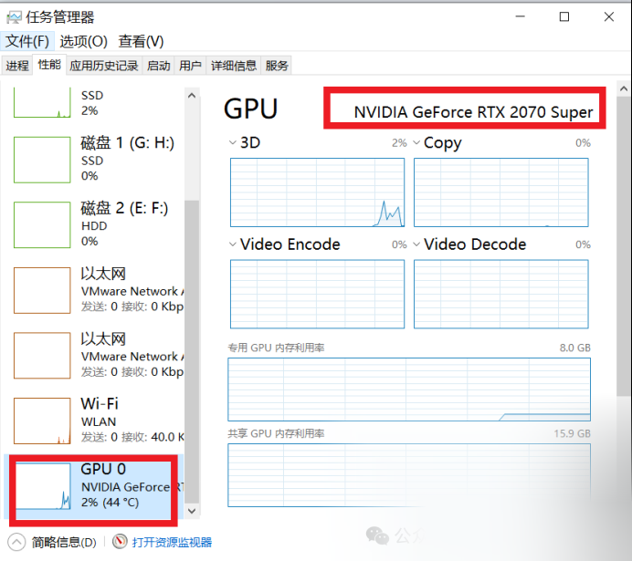
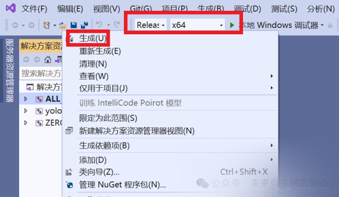

# [C++][cmake] deploying YOLOv12 object detection model with TensorRT support on Windows for image and video inference

Recently, the Yolov12 framework quietly emerged, marking another powerful tool for object detection. I attempted to deploy the Yolov12 TensorRT model on Windows and ultimately succeeded.

Important Notice: The installation environment is considered the most basic operation. This article does not provide specific steps for the environment, and you can search for the corresponding installation steps on .

Test passed environment:

vs2019

Windows 10 RTX2070 8G VRAM

cmake==3.30.1

cuda11.8.0+cudnn8.9.7

Tensorrt==8.6.1.6

opencv==4.9.0

anaconda3+python3.10

torch==2.5.1+cu124

Deployment process:

The most time-consuming step in deployment is setting up the environment. First, ensure that your computer is running Windows 10 or Windows 11 and that it has a NVIDIA graphics card installed. To check your graphics card, open Task Manager (for Windows 10, use Ctrl+Alt+Delete; for Windows 11, use Ctrl+Shift+ESC). In the Performance tab, you can see the details of your graphics card, as shown in the image below.

If you see GPU0 and GPU1, etc. indicating graphics cards, but only the presence of the "NVIDIA" logo indicates an independent graphics card. Other options are AMD graphics cards or integrated graphics, which cannot be used for CUDA, meaning that the computer does not support TensorRT acceleration or use of CUDA.

Firstly, everyone needs to install VS2019 or VS2022, and the following environment. Since there are many installation packages, you need to search and download them from the official website yourself. The versions can vary, but if you want to quickly reproduce this project, it is best to install a consistent version so that you can reproduce the project more quickly.

cmake==3.30.1

cuda11.8.0+cudnn8.9.7

Tensorrt==8.6.1.6

opencv==4.9.0

anaconda3+python3.10

torch==2.5.1+cu124

Assuming everyone has installed the above environment. Below, how to deploy it specifically: firstly, download the Yolov12 model from the official repository of Yolov12, and then download yolov12n.pt.

Then put the pt model into the project, switch to the Yolov12 environment that you have installed and switch to the project directory, and use the following command to directly convert.

yolo export model=yolov12n.pt format=onnx dynamic=False opset=12

After obtaining the ONNX model, we began compiling the source code.

First, we modify the CMakeLists.txt file by changing the paths of opencv and tensorrt in the source code to our own paths.

# Find and include OpenCV

set(OpenCV_DIR "D:\\lufiles\\opencv490\\build\\x64\\vc16\\lib")

# Set TensorRT path if not set in environment variables

set(TENSORRT_DIR "D:\\lufiles\\TensorRT-8.6.1.6")

Then execute

mkdir build

cd build

cmake ..

Afterwards, locate the sln file in the build folder and open it with Visual Studio. Then, select x64 release and check all options by right-clicking on ALL_BUILD and selecting "Generate".

Afterwards, a yolov12-tensorrt.exe file is generated under the build\Release folder. We then proceed to convert ONNX models into TensorRT models by executing commands.

trtexec --onnx=yolov12n.onnx --saveEngine=yolov12n.engine --fp16

Wait for more than 20 minutes, and the file yolov12n.engine will be automatically generated.

Now, let's begin testing the images.

yolov12-tensorrt.exe yolov12n.engine "test.jpg"

Then test the video.

yolov12-tensorrt.exe yolov12n.engine "car.mp4"

Special Attention:

1.

TensorRT models rely on hardware, so they are not universal and require re-conversion on a computer; otherwise, they may not be usable.

1.

For secondary development, one must understand the calling code and possess a certain foundation in C++ to be able to carry out secondary development.

## Payment

Here is a pay link on Stripe ( https://buy.stripe.com/3cs8yP7sY87d0vu9AB ). Please contact me lonlonago@foxmail.com after funding $89, and I will send you a complete data files , thank you!

